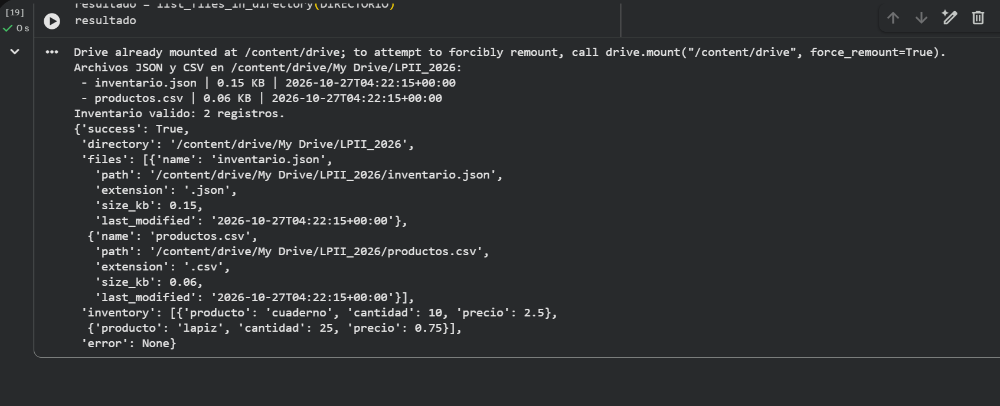

# Explorador de archivos de Google Drive

Módulo de Python para Google Colab que monta Drive, busca archivos `.json` y
`.csv` en un directorio configurado y devuelve sus metadatos en un diccionario
que puede consumirse desde una API. Si encuentra `inventario.json`, verifica
que contenga una lista de objetos JSON.

## Requisitos

- Python 3.8 o posterior.
- Para montar Drive, ejecutar el programa en Google Colab con acceso a Google
  Drive.

## Uso en Google Colab

1. Copia `modulo_drive.py` al cuaderno o al entorno de Colab.
2. Ajusta la constante `DIRECTORIO` al directorio que quieras explorar.
3. Ejecuta el archivo. Se solicitará autorización para montar Google Drive:

   ```python
   from modulo_drive import DIRECTORIO, list_files_in_directory, mount_google_drive

   mount_google_drive()
   resultado = list_files_in_directory(DIRECTORIO)
   ```

La ruta inicial configurada es `/content/drive/My Drive/LPII_2026`. En algunas
sesiones de Colab, la carpeta puede estar montada como
`/content/drive/MyDrive`; si es así, actualiza `DIRECTORIO`.

La respuesta contiene `success`, `directory`, `files`, `inventory` y `error`.
Cada elemento de `files` tiene nombre, ruta, extensión, tamaño en KB y fecha de
última modificación ISO 8601. `inventory` es la lista validada o `null` si no
existe el archivo. Los errores previstos de directorio o formato se devuelven
en `error` y también se muestran en consola.

## Captura de prueba

La siguiente captura muestra una ejecución real en Google Colab, con los
archivos encontrados, sus metadatos y los registros validados del inventario:



## Licencia

Este proyecto se distribuye bajo la licencia MIT. Consulta [LICENSE](LICENSE).
